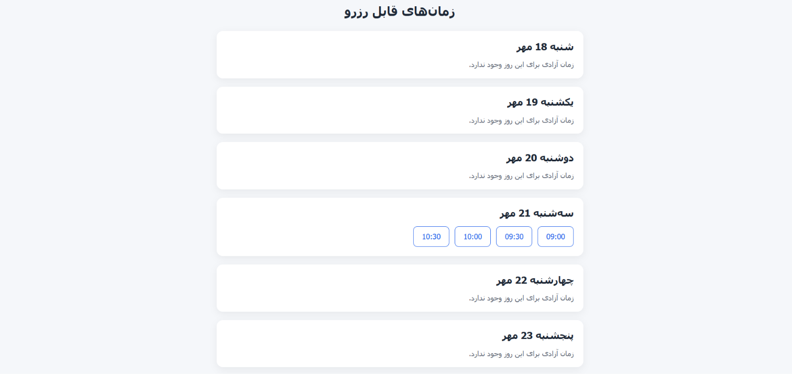
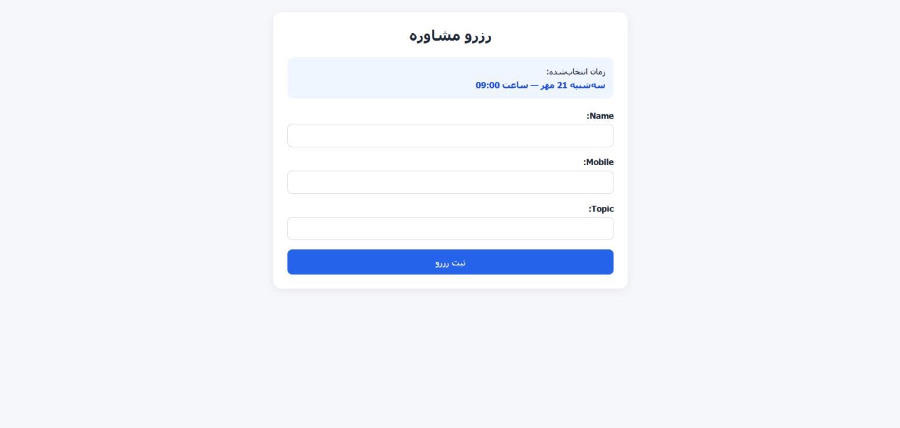
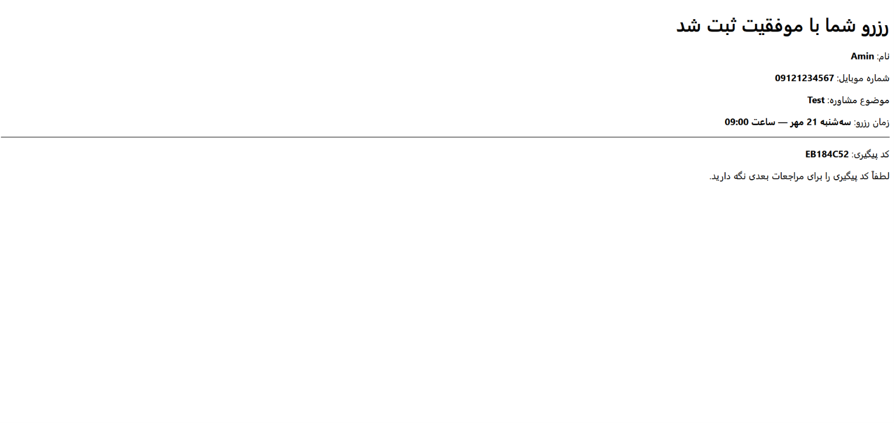
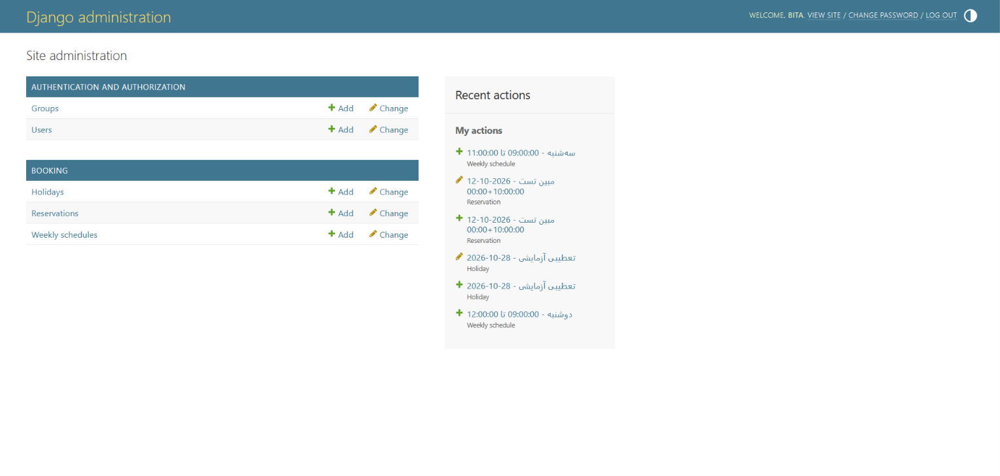
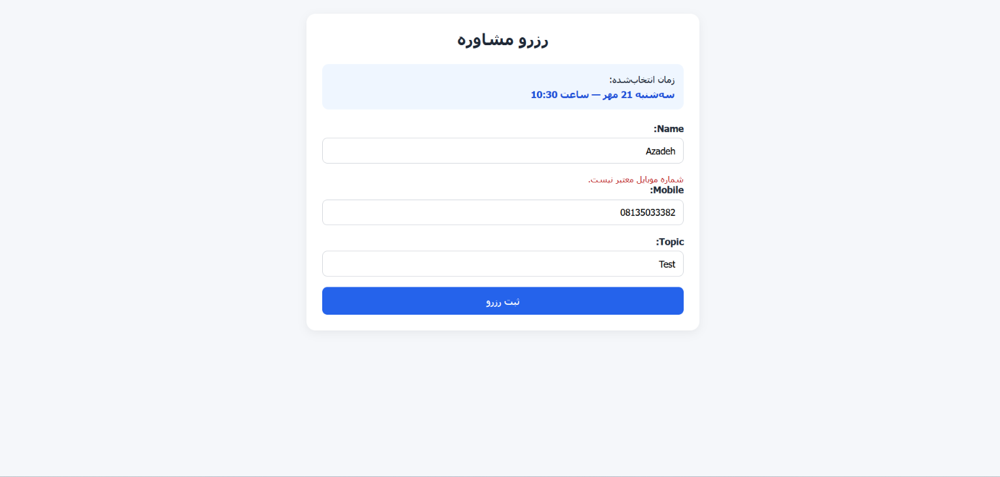

# Consultation Booking System

A Django-based consultation booking system for managing free consultation appointments.

Users can view available consultation slots for the next 7 days, select a suitable time, submit their reservation information, and receive a unique tracking code after a successful booking.

The system also includes an admin panel for managing weekly schedules and holidays, validates Iranian mobile numbers, prevents duplicate bookings, and displays dates in the Jalali calendar.

## Features

- Display available consultation slots for the next 7 days
- Jalali (Persian) date display using `jdatetime`
- Weekly schedule management through Django Admin
- Holiday management through Django Admin
- Automatic slot generation based on session duration
- Removal of past consultation times
- Removal of already booked slots
- Iranian mobile number validation
- Support for Persian mobile number digits
- Prevention of duplicate active reservations
- Database-level protection against concurrent duplicate bookings
- Unique tracking code generation for each reservation
- Reservation confirmation page
- RTL and mobile-friendly user interface
- Protection against missing or malformed reservation slot URLs
- Automated tests for booking logic, validation, constraints, and views

## Tech Stack

- Python 3.11
- Django 5.2
- SQLite
- jdatetime
- HTML5
- CSS3
- Django Templates
- Django Admin
- Git

## Installation

1. Clone the repository:

```bash
git clone <repository-url>
```

2. Navigate to the project directory:

```bash
cd consultation-booking
```

3. Create a virtual environment:

```bash
python -m venv .venv
```

4. Activate the virtual environment:

### Windows PowerShell

```powershell
.venv\Scripts\Activate.ps1
```

5. Install project dependencies:

```bash
pip install -r requirements.txt
```

## Environment Variables

The project reads the Django secret key from an environment variable.

### Windows PowerShell

```powershell
$env:DJANGO_SECRET_KEY="your-secret-key-here"
```

If the environment variable is not set, the project uses a development-only fallback value.

Do not use the fallback value in production.

## Database Setup

Apply the database migrations:

```bash
python manage.py migrate
```

## Create Superuser

Create an admin user:

```bash
python manage.py createsuperuser
```

Then follow the prompts to set the username, email, and password.

## Run the Project

Start the Django development server:

```bash
python manage.py runserver
```

Then open the availability page in your browser:

```text
http://127.0.0.1:8000/availability/
```

## Run Tests

Run the booking app test suite:

```bash
python manage.py test booking
```

The project currently includes automated tests for:

- Slot generation
- Past slot rejection
- Holiday handling
- Booked and cancelled reservations
- Iranian mobile number validation
- Persian digit normalization
- Duplicate reservation protection
- Database constraints
- Reservation form validation
- Reservation views
- Tracking code display
- Missing and malformed slot handling

## Project URLs

After starting the development server, the main project URLs are:

- Availability page:

```text
http://127.0.0.1:8000/availability/
```

- Reservation page:

```text
http://127.0.0.1:8000/reserve/
```

- Django Admin:

```text
http://127.0.0.1:8000/admin/
```

The reservation page is normally accessed by selecting an available time from the availability page.

## Screenshots

### Availability



### Reservation Form



### Reservation Success



### Django Admin



### Mobile Validation



## Notes

- The project uses SQLite for simplicity and local development.
- The Django secret key is read from the `DJANGO_SECRET_KEY` environment variable.
- A development-only fallback secret key is provided for local use.
- The reservation page is intended to be accessed through the availability page after selecting a valid slot.
- Past, booked, and holiday slots are automatically excluded from availability.
- Duplicate active reservations are protected at both application and database levels.
- The project currently includes 26 automated tests.